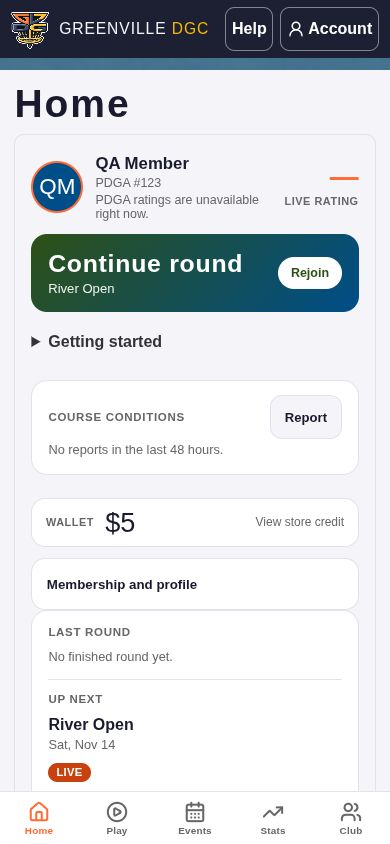
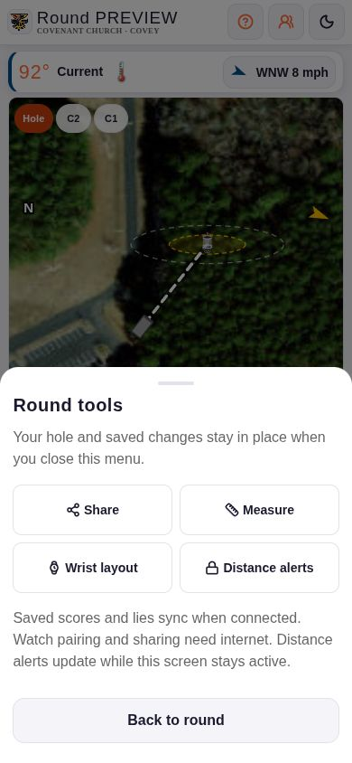
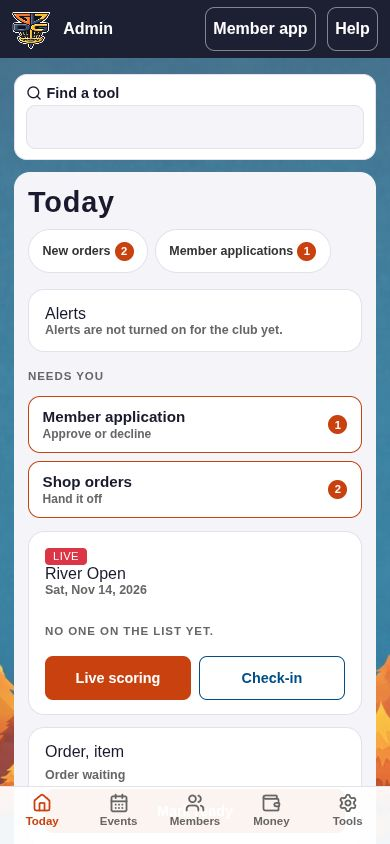
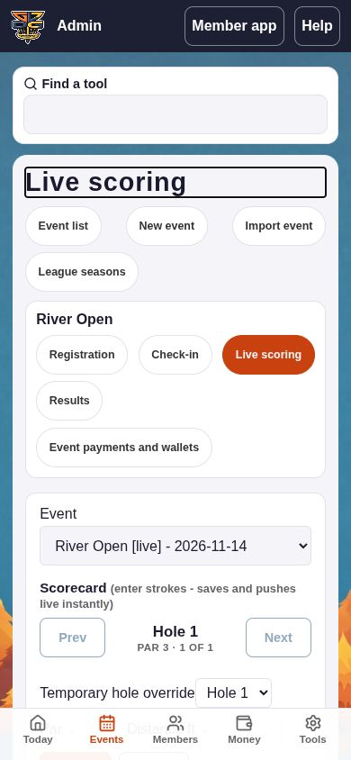
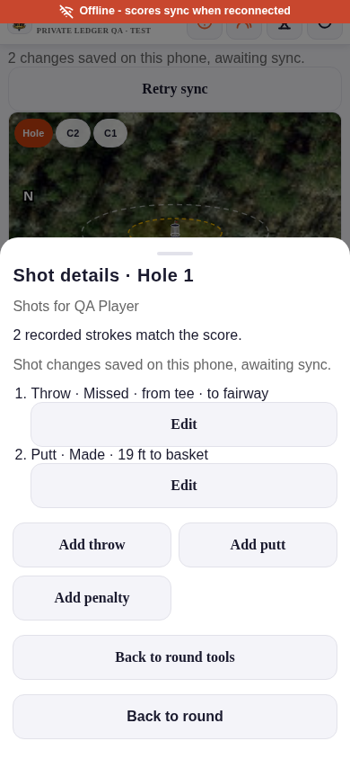
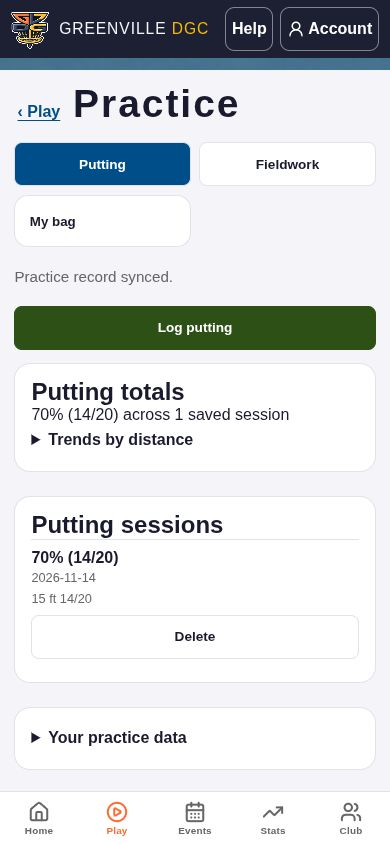
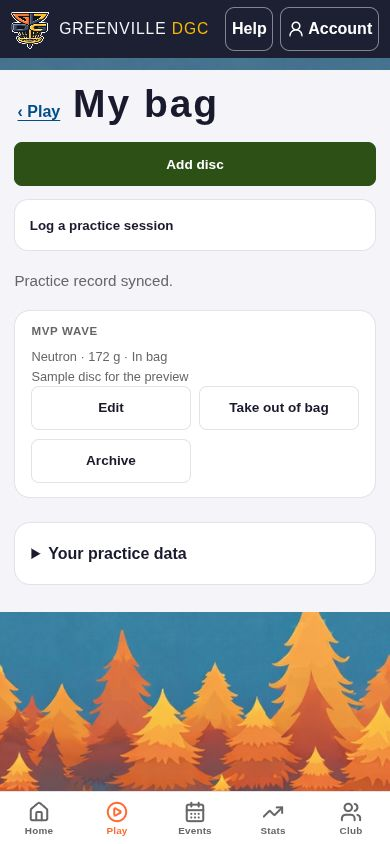

# GVDG app previews

These screenshots use sample data. Open an image to zoom in. The gallery can be viewed in a normal phone browser if inline images do not render in Codex.

## Live navigation release

Deployed in [PR #92](https://github.com/kgbrah/gvdg-club-site/pull/92). Open the [member app](https://gvdgclub.com/gvdg-members.html) to use the current release.

### Member Home

### Round tools

### Admin Today

### Event workspace

## Next release previews

Under review in [PR #93](https://github.com/kgbrah/gvdg-club-site/pull/93). These features have not deployed yet.

### Shot details

### Practice

### My bag

