# App-wide visual polish

Actual working components with synthetic accounts and rounds. The user approved the revised Home direction and the bottom-control scorecard layout, including the image-credit and compact-name refinements shown here. Final combined release checks are tracked in PR #96. Native hardware and store publication are not represented by browser previews.

## Approved scorecard on a phone

Scoring and previous/next-hole controls stay at the bottom. Weather and wind stay visible above the map. Map buttons sit outside the image, and attribution sits inside it. Compact names use a smaller given name above an emphasized surname while retaining the full accessible name.

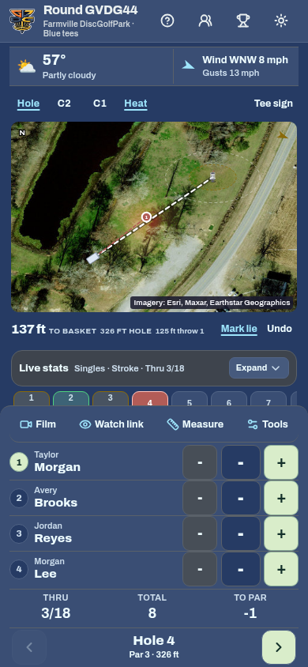

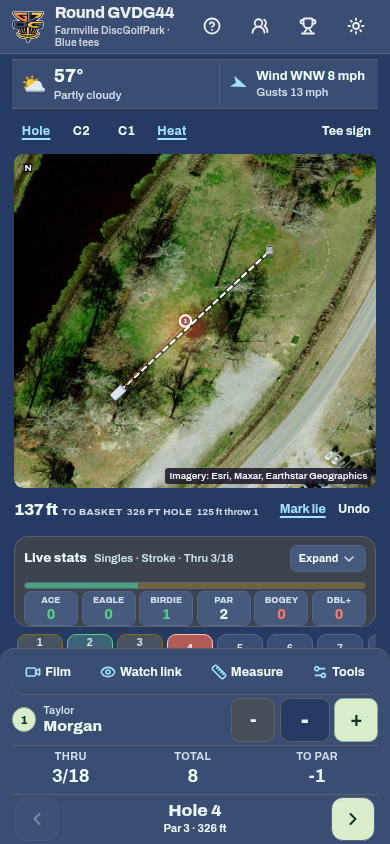

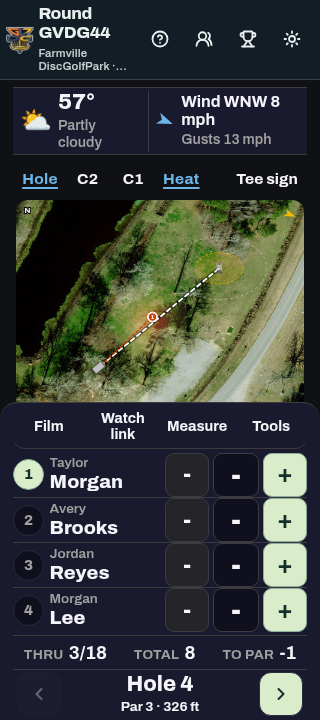

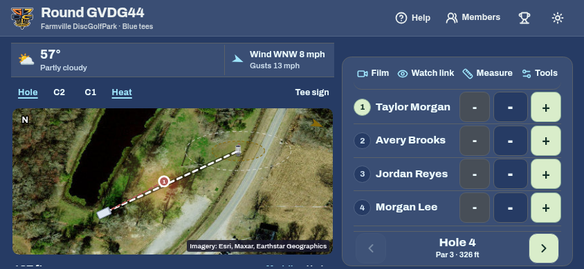

## Member Home and Account

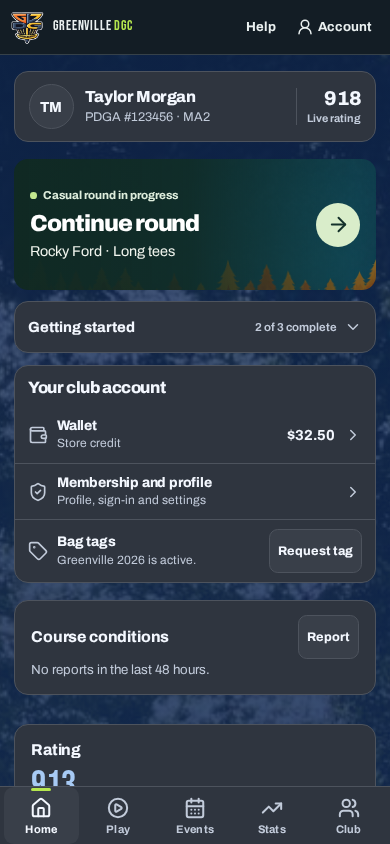

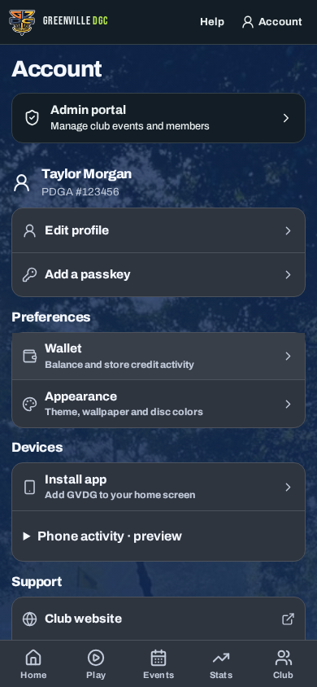

## Member Play

## My bag: choices and voice entry

Brand, model and plastic suggestions are searchable and accept custom values. Voice entry offers an editable transcript and fills only empty fields after review; saving remains a separate action. Recognition requires browser support and permission. These browser tests simulate recognition results rather than recording a real microphone.

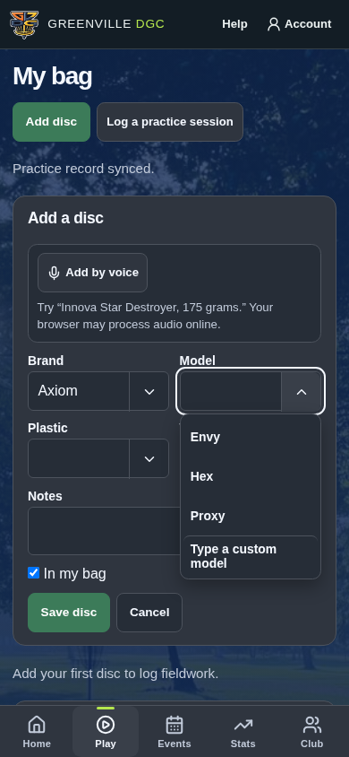

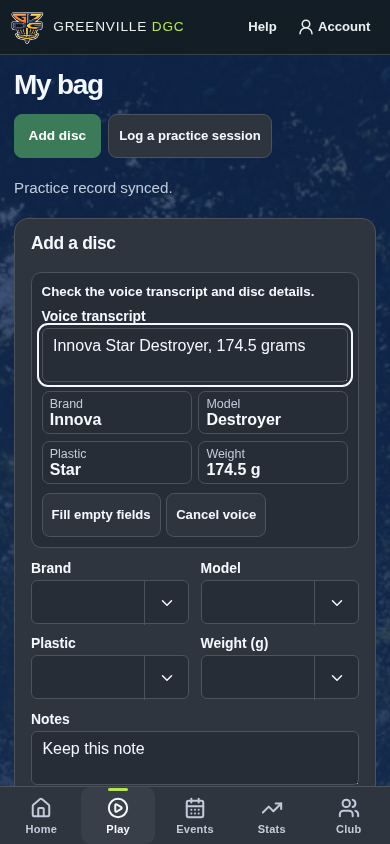

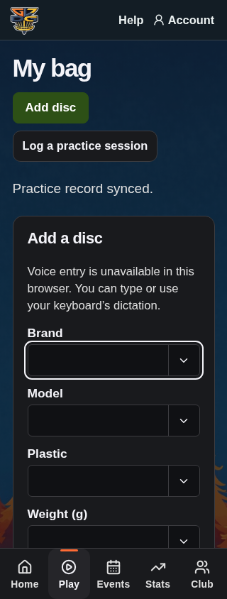

## Admin Today and New event

The Admin, Member app and Help header labels remain readable in light mode and over custom wallpaper. All three measured 14.81:1 contrast across the checked 320, 390 and 1280 px layouts.

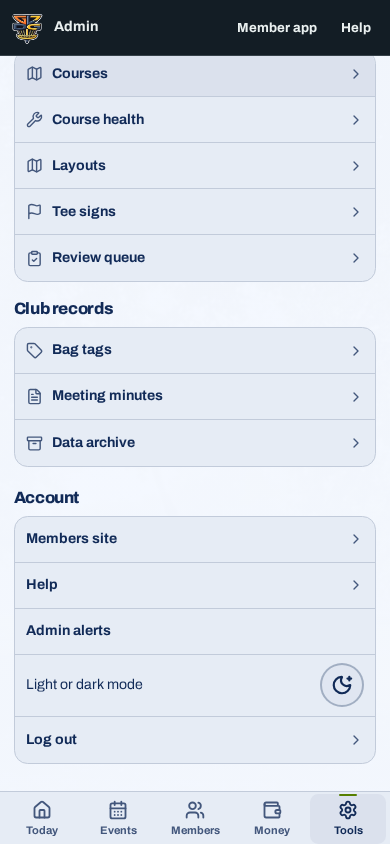

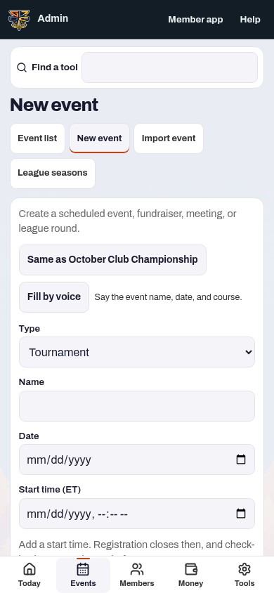

## Public Events, Shop and app guide

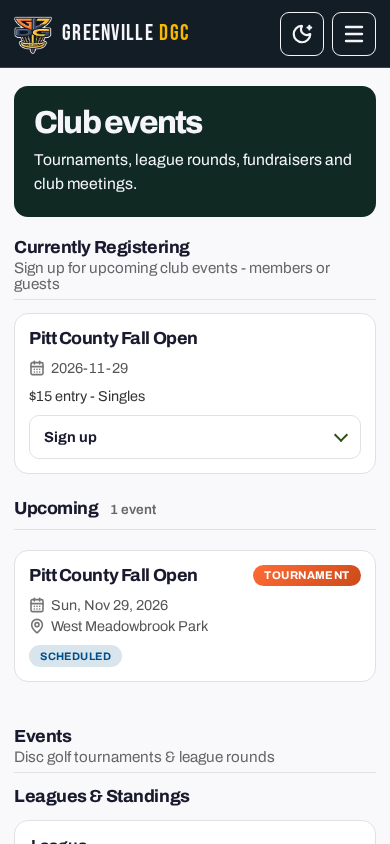

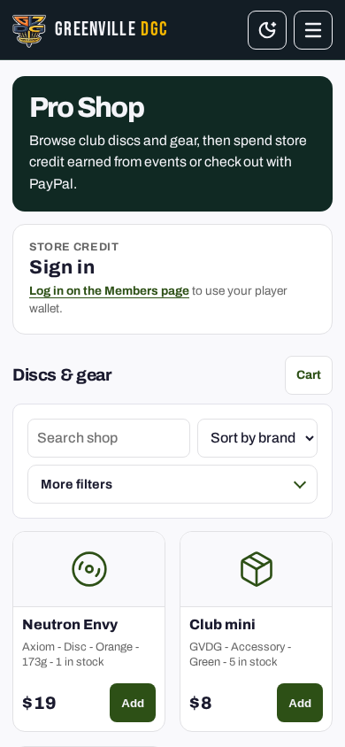

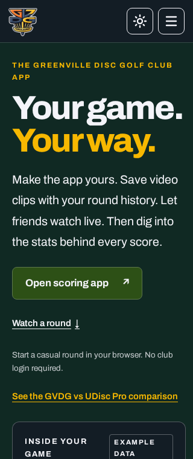

## Shared Help

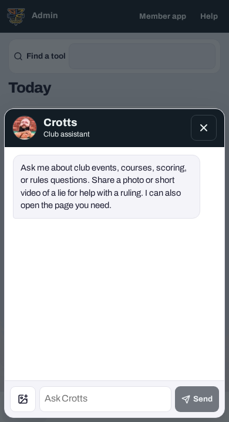

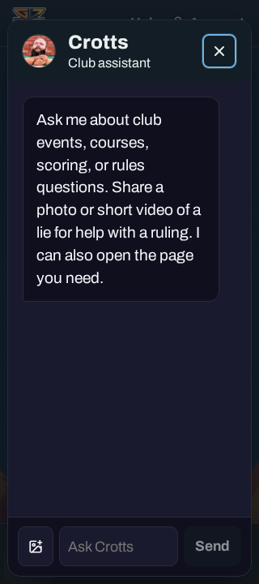

These captures use fixture data. Checkout and Help requests were intercepted locally; no payments or messages were sent. Scorecard checks include rapid taps, score corrections, lost acknowledgements, offline marked lies, incomplete-card blocking, shotgun match-play completion and weighted putting.
