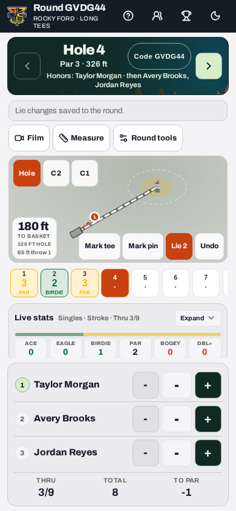
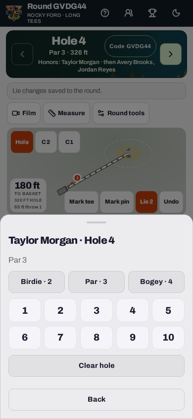
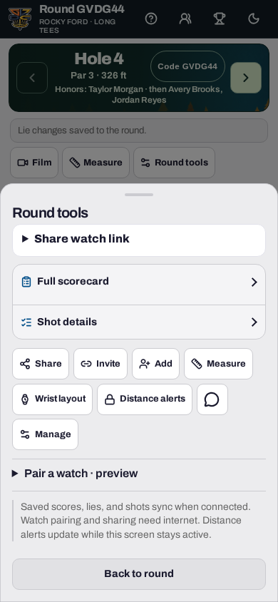
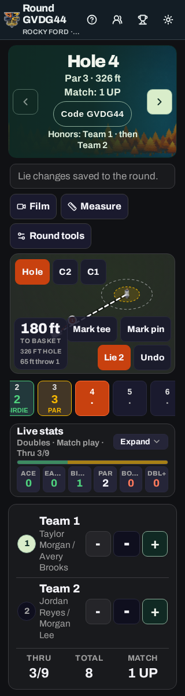
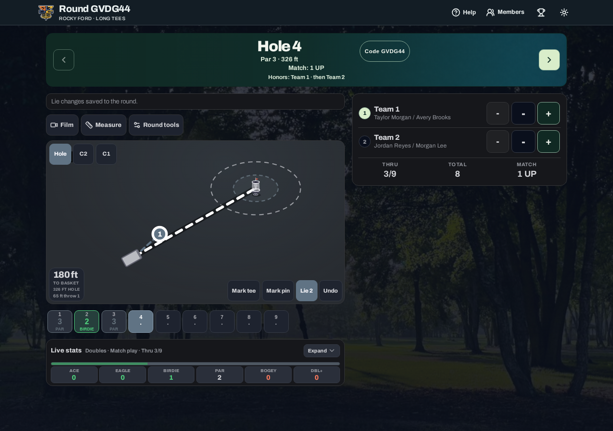
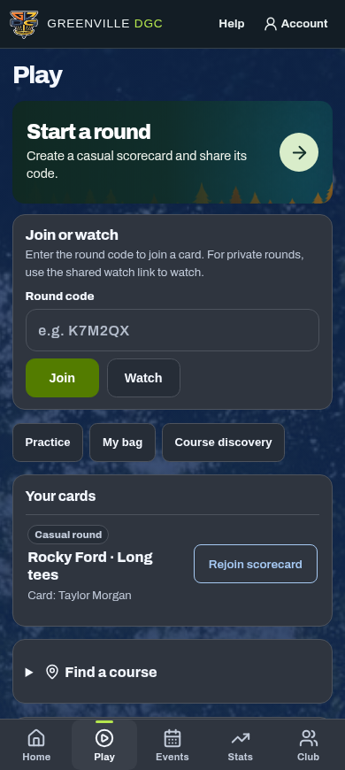
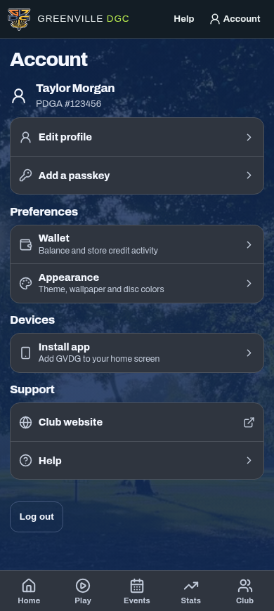
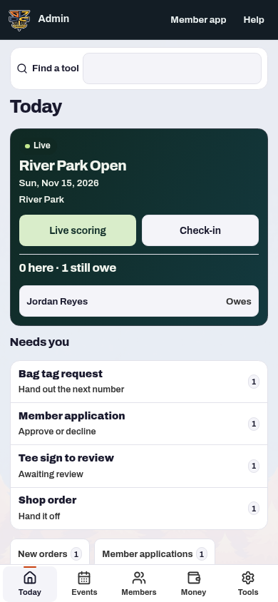

# App-wide visual polish

**Scorecard iteration rejected by the user; do not deploy these scorecard visuals.** The user requested less crowding and visible weather/wind. New scorecard alternatives are being prepared for fresh approval. Member/admin captures below still document their completed lane.

Actual working components with synthetic accounts and rounds. Integration continues in draft PR #96. Native hardware/store publication is not represented by browser previews.

## Scorecard on a phone

## Score keypad and round tools

## Small phone with enlarged text

## Desktop with a custom theme

## Member Play and Account

## Admin Today and New event

The scorecard checks include rapid taps, score corrections, lost acknowledgements, reload/reconnect, offline marked lies, incomplete-card blocking and shotgun match-play completion. Public page and shared Help previews will be added after their final review.
