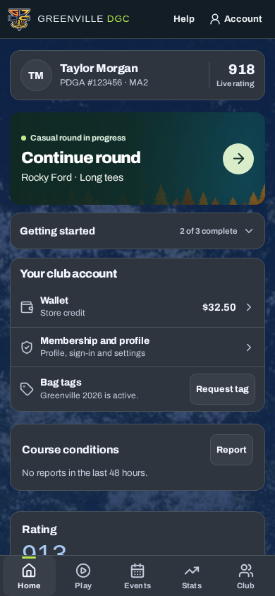
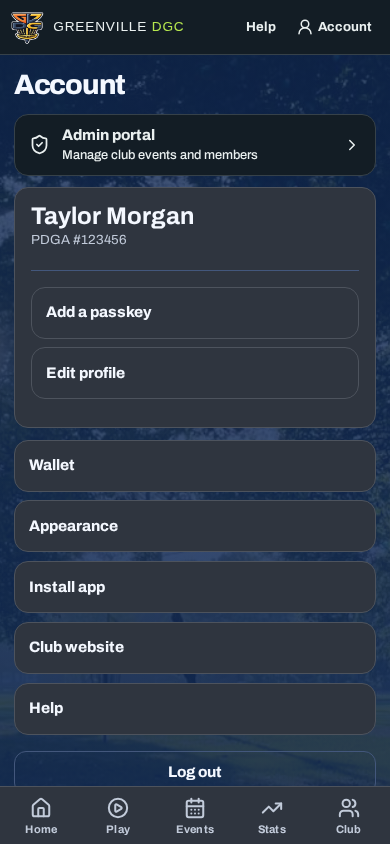
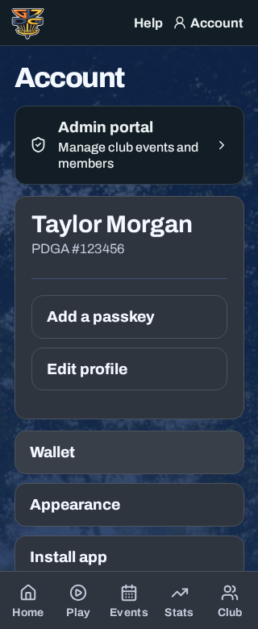

# Home and Account cleanup

Actual member components with a synthetic account and a custom blue theme. The redundant visible Home heading and admin link are removed; the accessible Home page heading and bottom Home navigation remain. Admin access is a single banner at the top of Account, only for admins. Account links and buttons share the inherited font family and consistent size, weight and line-height.

Verified at320/390/1280 in light, dark and custom blue; no-admin accounts do not show the banner. Existing profile, passkey, wallet, appearance, install, Help and logout actions remain.
