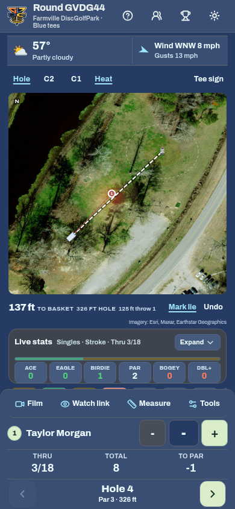
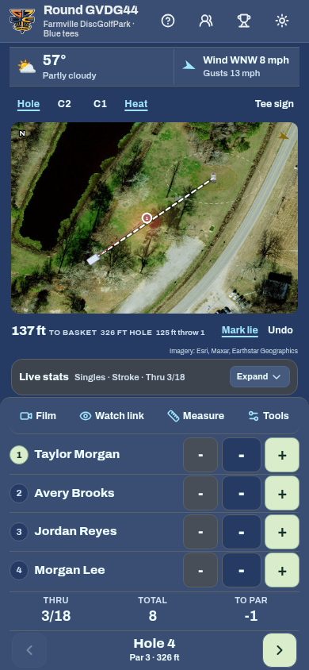
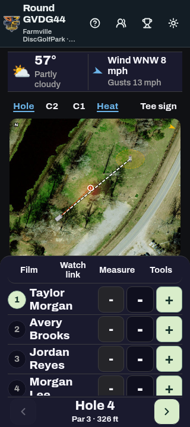
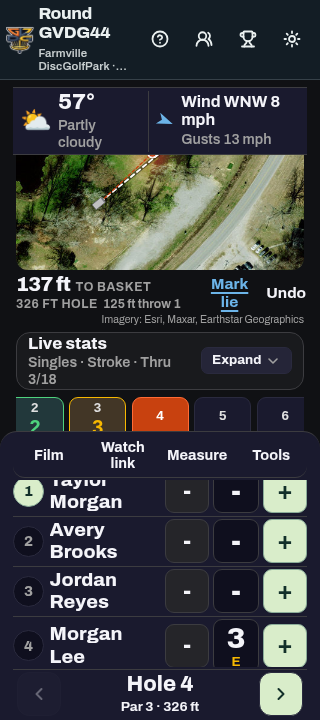
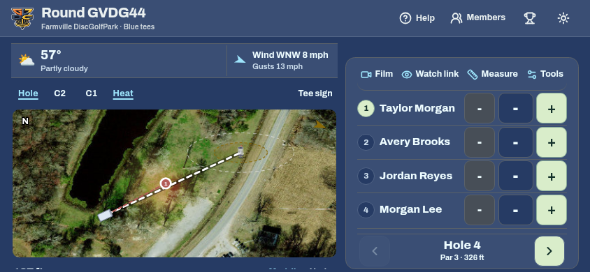

# Scorecard with controls at the bottom

Proposed revision for review; not deployed. These are actual application components with sample players, weather, and mapped hole data. This replaces both earlier rejected directions.

Scoring and previous/next-hole navigation stay anchored at the bottom. Weather, wind direction/speed and gusts remain above the map. The large map has no button overlays. Circle/heat/tee-sign controls sit above it; range, Mark lie and Undo sit below. Occasional tee and pin adjustments are in Tools. Film, Watch link and Measure remain readily available.

## One player on a phone

## Four players on a phone

## Small phone with enlarged text

At 320px with enlarged text, the map area and player list scroll independently. The fourth player can be brought fully into view while hole navigation stays anchored.

## Landscape

Chromium checks cover touch scoring, score retention across hole changes, focus and Escape, reaching the last player and Mark lie, and simulated keyboard/safe-area offsets. Actual phone keyboard timing and device cutouts still require device checks.
