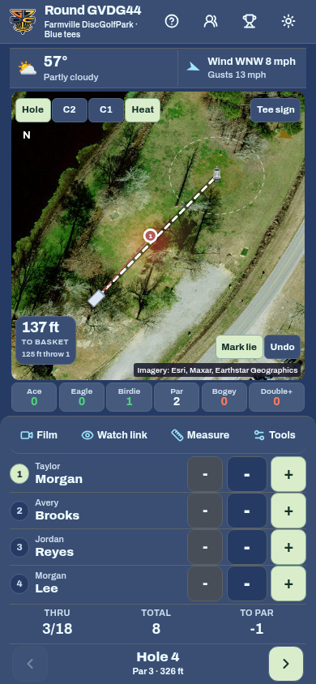
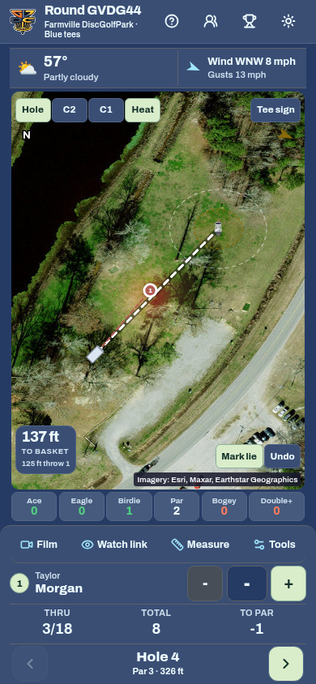
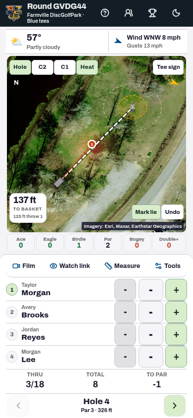

# Scorecard: fitted map and compact distance badge

Actual app screenshots with sample players and round data, at a 390 × 844 phone viewport.

The map controls sit inside the image. The rounded corner badge shows distance to the basket and the last throw; the hole length appears once, beside the bottom hole controls. Weather and six outcome counts stay visible. Scoring and hole navigation remain at the bottom.

Detailed stats, hole selection and saved clips are available under **Tools → Round details**. On short screens the player list can scroll independently.

## Four players

## Solo round

## Light mode

