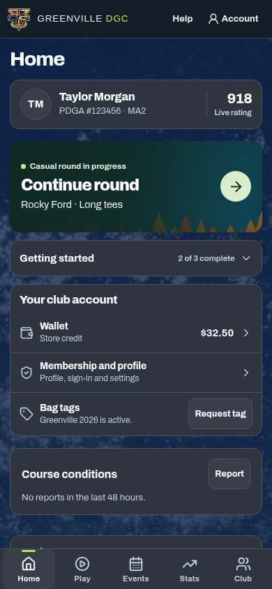
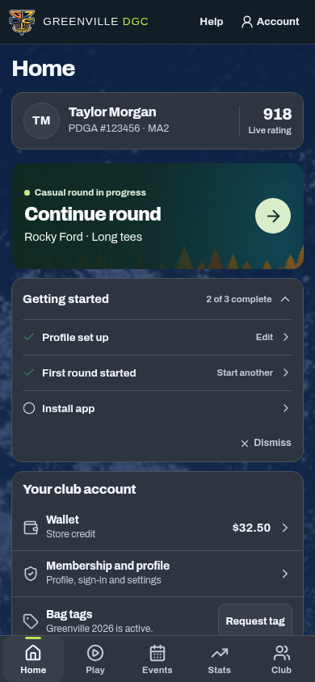
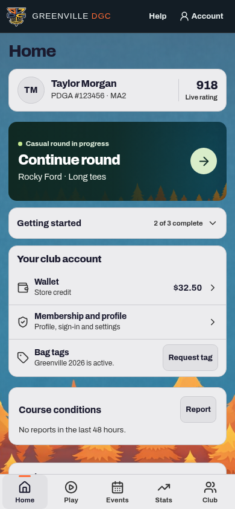
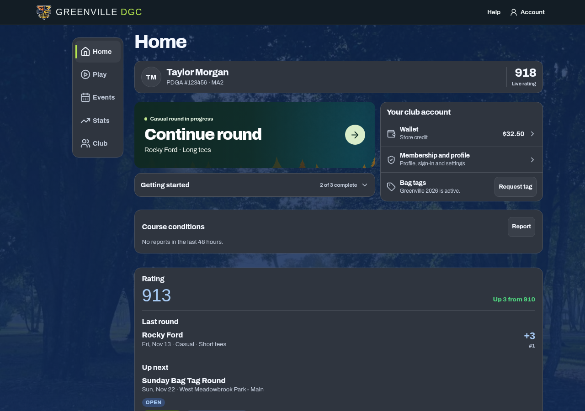

# Member Home — revised visual design

Working-interface screenshots with sample member data. **Not deployed.** This revision responds to the oversized onboarding buttons and inconsistent account controls in the previous Home screen.

- Compact, theme-aware surfaces and a clear Continue round action.
- Wallet, membership and bag tags in an aligned account section.
- A collapsible checklist that recognizes completed steps, with a discreet dismiss action.
- Smaller, consistent secondary controls; custom wallpaper remains available.

## Blue custom theme

## Expanded checklist

## Light theme

## Desktop

